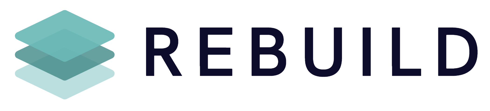

  <a href="https://rebuild-nl.vercel.app/v2">
    <picture>
      <source media="(prefers-color-scheme: dark)" srcset="assets/logo-lockup-light-text.png">
      
    </picture>
  </a>

<h3 align="center">AI-automatisering voor bedrijven</h3>

  <em>We rebuild systems, workflows, processes, operations and the future.</em>

  <a href="https://rebuild-nl.vercel.app/v2">Website</a> ·
  <a href="https://rebuild-nl.vercel.app/v2/ai-check">Gratis AI-check</a> ·
  <a href="https://rebuild-nl.vercel.app/v2/werkwijze">Werkwijze</a> ·
  <a href="https://rebuild-nl.vercel.app/v2/projecten">Projecten</a> ·
  <a href="https://rebuild-nl.vercel.app/v2/contact">Kennismaking</a>

 

## Wie we zijn

REBUILD is een AI-automatiseringsbureau uit Amsterdam. Samen met bedrijven zoeken we waar tijd verloren gaat aan handwerk, en dat automatiseren we met AI, op de systemen die ze al gebruiken.

We gooien niks weg. We bouwen het slimmer op.

## Dit doen we

| | |
|---|---|
| **Bedrijfsautomatisering** | Handwerk in bestaande processen laten verdwijnen. |
| **AI-agents** | Een digitale collega die terugkerende taken uitvoert. Jij bepaalt wat hij mag. |
| **AI-chatbots** | Beantwoordt vragen van klanten in gewone taal, op basis van jouw eigen informatie. |
| **AI-integraties** | AI gekoppeld aan wat er al is: CRM, boekhouding, mail en agenda. |
| **App-ontwikkeling** | Een eigen web- of mobiele app, gekoppeld aan je systemen. |
| **Data en dashboards** | Je cijfers op één plek, automatisch bijgewerkt. |
| **Procesautomatisering** | Terugkerend werk dat vanzelf door je systemen loopt. |
| **Maatwerksoftware** | Software die past bij jouw processen, in plaats van andersom. |

## Hoe we werken

1. **Kennismaking** – een vrijblijvend gesprek over hoe je werkt en waar het knelt.
2. **Analyse** – we brengen samen één proces in kaart: wie doet wat, in welke systemen.
3. **Kansen kiezen** – per stap bepalen we wat AI overneemt en waar een mens beslist.
4. **Bouwen** – in korte rondes, op je bestaande systemen. Tussendoor probeer je werkende versies uit.
5. **Live** – uitzonderingen en goedkeuring blijven bij je team. Wij leggen uit hoe het werkt.
6. **Meten en verbeteren** – een volgend proces bouwt verder op wat er al staat.

## Werkt met wat je al gebruikt

OpenAI · Claude · Google · Microsoft · Azure · AWS · Google Cloud · NVIDIA · Supabase · Airtable · HubSpot · Salesforce · Exact · AFAS · Shopify · Stripe · WhatsApp · Gmail · Slack · Zapier · Make · n8n

## Over deze GitHub

Het werk dat we bouwen is maatwerk voor onze klanten en staat daarom niet publiek op GitHub. Wil je zien wat we maken? Bekijk onze [projecten](https://rebuild-nl.vercel.app/v2/projecten) of [plan een kennismaking](https://rebuild-nl.vercel.app/v2/contact).

## Contact

**REBUILD**
Johannes Verhulststraat 115-H
1071 NL Amsterdam

[info@rebuildnow.nl](mailto:info@rebuildnow.nl) · [rebuild.nl](https://rebuild-nl.vercel.app/v2)

 

  © 2026 REBUILD · Alle rechten voorbehouden

