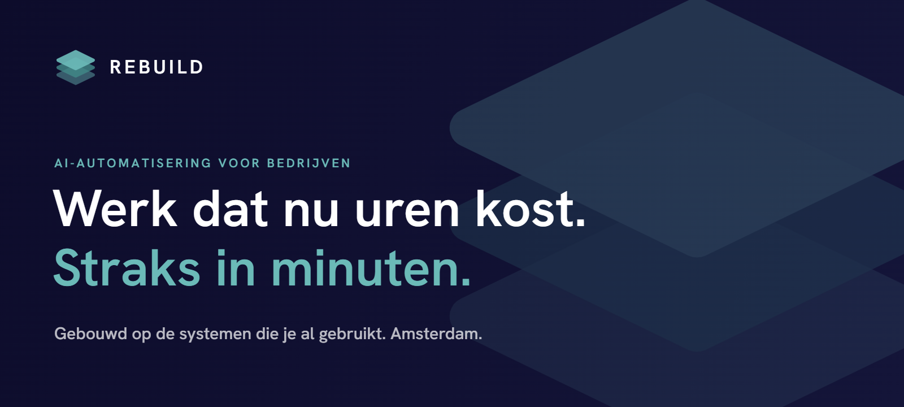
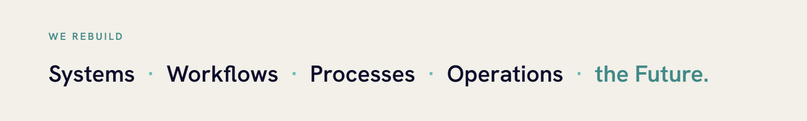

  &nbsp;
  &nbsp;
  &nbsp;
  

 

## We gooien niks weg. We bouwen het slimmer op.

Elk bedrijf heeft werk dat elke week terugkomt: overtypen, mailen, bellen, plannen, cijfers bij elkaar zoeken. Wij halen dat eruit. Niet met nieuwe software, maar met AI op de systemen die er al staan.

Je houdt zelf de regie. Jij bepaalt wat automatisch mag en waar een mens beslist. Wij bouwen, testen en onderhouden.

 

<picture>
  <source media="(prefers-color-scheme: dark)" srcset="assets/band-dark-1600x260.png">
  
</picture>

 

## Dit bouwen we

<table>
  <tr>
    <td width="50%" valign="top"><b>Bedrijfsautomatisering</b> Het handwerk uit je processen halen. Van offerte tot factuur.</td>
    <td width="50%" valign="top"><b>AI-agents</b> Een digitale collega die terugkerende taken oppakt. Jij bepaalt wat hij mag.</td>
  </tr>
  <tr>
    <td valign="top"><b>AI-chatbots</b> Beantwoordt klantvragen in gewone taal, op basis van jouw eigen informatie.</td>
    <td valign="top"><b>AI-integraties</b> AI gekoppeld aan je CRM, boekhouding, mail en agenda.</td>
  </tr>
  <tr>
    <td valign="top"><b>App-ontwikkeling</b> Een eigen web- of mobiele app, gekoppeld aan je systemen.</td>
    <td valign="top"><b>Data en dashboards</b> Je cijfers op één plek, automatisch bijgewerkt.</td>
  </tr>
  <tr>
    <td valign="top"><b>Procesautomatisering</b> Terugkerend werk dat vanzelf door je systemen loopt.</td>
    <td valign="top"><b>Maatwerksoftware</b> Software die past bij jouw proces, in plaats van andersom.</td>
  </tr>
</table>

 

## Zo werken we

We beginnen klein, met één proces. Na elke stap beslis jij of we doorgaan.

| | | |
|:-:|---|---|
| **1** | **Kennismaking** | Een gesprek over hoe je werkt en waar het knelt. Voorbereiden hoeft niet. |
| **2** | **Analyse** | We brengen samen één proces in kaart: wie doet wat, in welk systeem. |
| **3** | **Kansen kiezen** | Per stap bepalen we wat AI overneemt en waar een mens beslist. |
| **4** | **Bouwen** | In korte rondes, op je bestaande systemen. Tussendoor probeer je werkende versies uit. |
| **5** | **Live** | Uitzonderingen en goedkeuring blijven bij je team. Wij leggen uit hoe het werkt. |
| **6** | **Meten en verbeteren** | Het volgende proces bouwt verder op wat er al staat. |

 

## Werkt met wat je al gebruikt

  
  
  
  
  
  
  
  
  
  
  
  
  
  
  
  
  
  
  
  
  

Meestal hoef je niets te vervangen. We laten je systemen samenwerken, zodat gegevens niet meer met de hand van het ene naar het andere programma hoeven.

 

## Waarom hier geen code staat

Alles wat we bouwen is maatwerk voor onze klanten, en dat blijft van hen. Wil je zien wat we maken? Kijk bij onze [projecten](https://rebuildnow.nl/projecten) of [plan een kennismaking](https://rebuildnow.nl/contact).

 

<table width="100%">
  <tr>
    <td valign="top">
      <b>REBUILD</b> 
      Johannes Verhulststraat 115-H 
      1071 NL Amsterdam
    </td>
    <td valign="top" align="right">
      <a href="https://rebuildnow.nl">rebuildnow.nl</a> 
      <a href="mailto:info@rebuildnow.nl">info@rebuildnow.nl</a> 
      <a href="https://rebuildnow.nl/ai-check">Gratis AI-check →</a>
    </td>
  </tr>
</table>

© 2026 REBUILD · Amsterdam

